# StreetBite

**Discover meals, save your favorites, and keep your orders in one place.**

StreetBite is a Flutter food-discovery and ordering app. Browse and search meals, view recipes, manage your cart, and keep track of favorites and orders. The interface supports English and Arabic, with light and dark themes.

## Project structure

The app is organized by feature. Larger features separate data access, business logic, and UI into `data/`, `domain/`, and `presentation/` layers.

```text
street_bite/
├── android/                   Android app configuration
├── ios/                       iOS app configuration
├── assets/
│   ├── fonts/                 Inter typeface files
│   ├── images/                App logo, splash, and onboarding artwork
│   └── translations/          English (en.json) and Arabic (ar.json)
├── lib/
│   ├── main.dart              App entry point
│   ├── injection.dart         Dependency injection setup
│   ├── firebase_options.dart  Firebase platform configuration
│   ├── core/                  Shared app functionality
│   │   ├── constants/         Shared constants and asset references
│   │   ├── errors/            Error handling and failure mapping
│   │   ├── networking/        Dio client and API endpoints
│   │   ├── routing/           App routes and GoRouter configuration
│   │   ├── services/          Firestore and biometric services
│   │   ├── storage/           SharedPreferences helpers and keys
│   │   ├── theme/             Colors, typography, themes, and theme state
│   │   ├── utils/             Shared validators and utilities
│   │   └── widgets/           Reusable UI components
│   └── features/              Feature-specific app modules
│       ├── auth/              Sign-up, sign-in, and auth state
│       ├── cart/              Cart, payment methods, and order placement
│       ├── favorites/         Favorite meal management
│       ├── home/              Meal browsing, search, and API data
│       ├── main_layout_screen/ Main navigation and app layout
│       ├── meal_details/      Meal recipe and details screen
│       ├── onboarding/        First-run onboarding flow
│       ├── profile/           User profile and order history
│       └── splash/            Launch screen
├── screenshots/               App screenshots
└── test/                      Flutter tests
```

Feature modules separate data, domain, and presentation code where applicable.

## Contents

- [Project structure](#project-structure)
- [Features](#features)
- [Screenshots](#screenshots)
- [Built with](#built-with)
- [Getting started](#getting-started)
- [Run the app](#run-the-app)
- [Testing and analysis](#testing-and-analysis)

## Features

- **Authentication:** Sign up and sign in with Firebase Authentication.
- **Meal discovery:** Browse and search meals with TheMealDB; meal results are cached.
- **Meal details:** View meal information, ingredients, and cooking instructions.
- **Favorites and cart:** Save favorite meals and manage cart quantities.
- **Orders:** Place orders and view order history in a Firebase-backed profile.
- **Localization and themes:** Use the app in English or Arabic with light or dark themes.
- **Biometrics:** Authenticate with biometrics on supported devices.
- **Checkout:** Choose cash on delivery or simulated card payment. Card payments are not processed by a payment provider.

## Screenshots

Each screen is shown in two variants: Arabic with the light theme and English with the dark theme. Four screenshots appear per row (two screens per row). The splash screen has one available image and is included as its own full-width row. The [`screenshots/`](screenshots/) directory contains additional theme and language variants.

<table>
  <tr>
    <td align="center" colspan="4">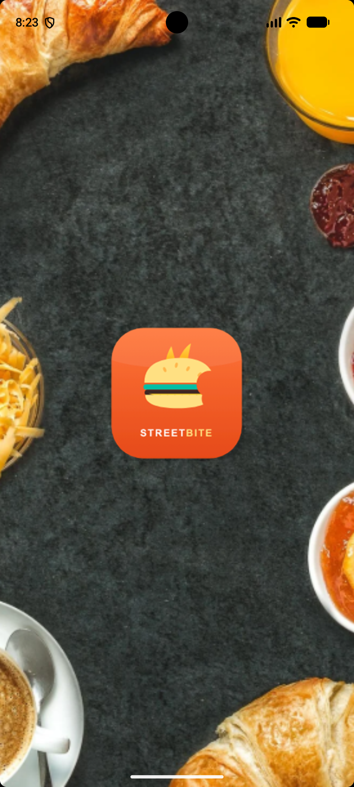<br><sub>Splash screen</sub></td>
  </tr>
  <tr>
    <td align="center">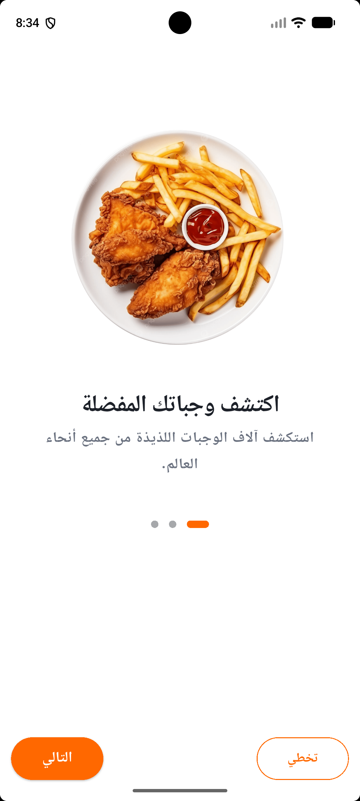<br><sub>Onboarding · Arabic · Light</sub></td>
    <td align="center">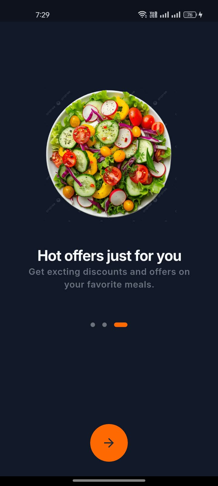<br><sub>Onboarding · English · Dark</sub></td>
    <td align="center"><br><sub>Login · Arabic · Light</sub></td>
    <td align="center">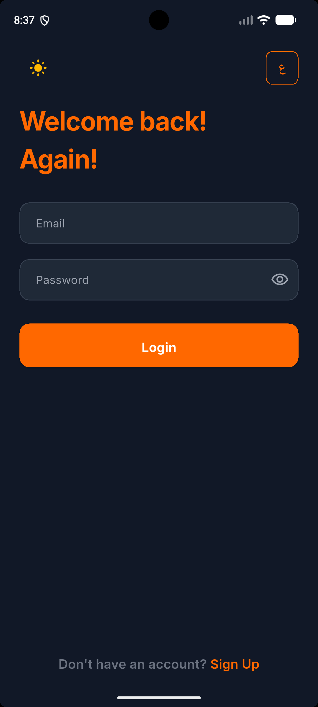<br><sub>Login · English · Dark</sub></td>
  </tr>
  <tr>
    <td align="center">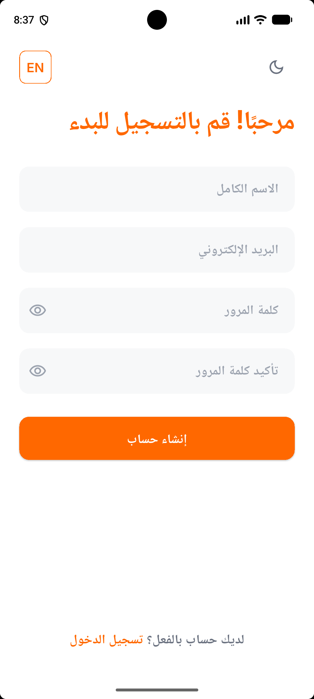<br><sub>Sign up · Arabic · Light</sub></td>
    <td align="center">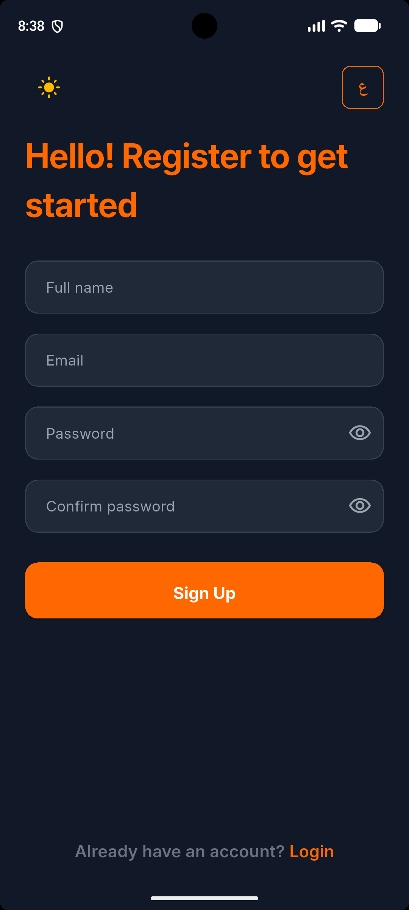<br><sub>Sign up · English · Dark</sub></td>
    <td align="center">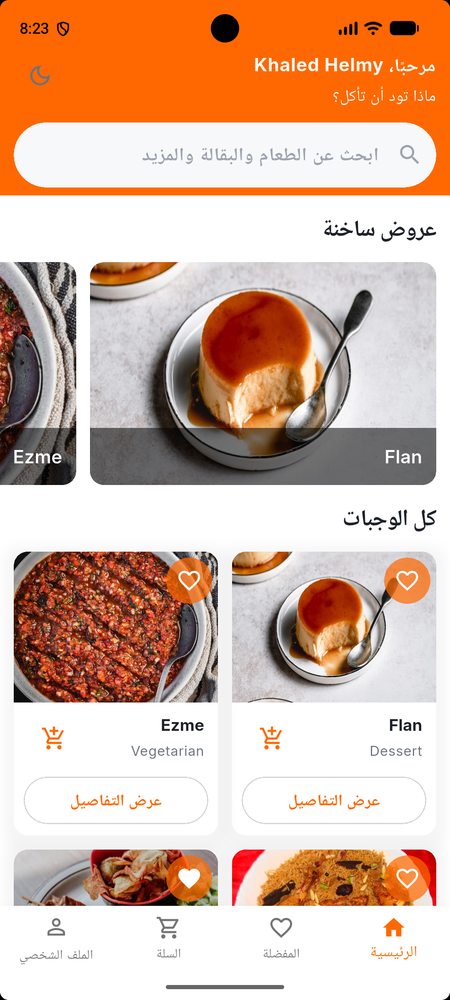<br><sub>Home · Arabic · Light</sub></td>
    <td align="center">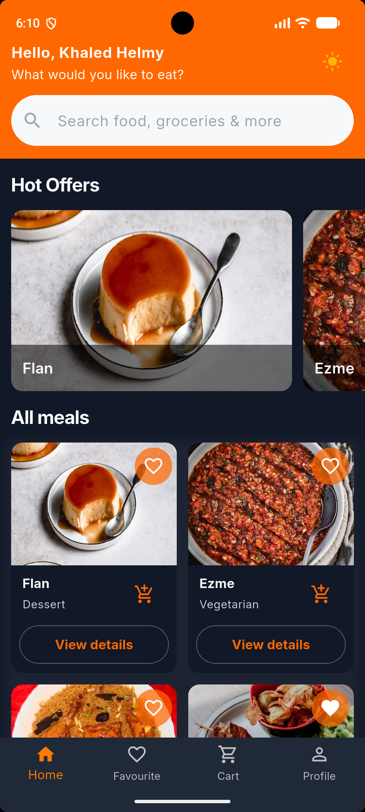<br><sub>Home · English · Dark</sub></td>
  </tr>
  <tr>
    <td align="center">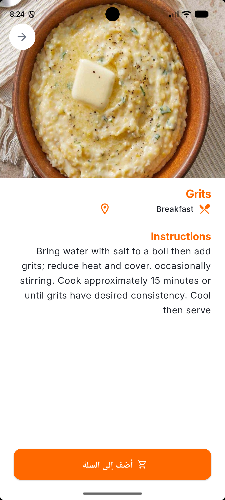<br><sub>Meal details · Arabic · Light</sub></td>
    <td align="center">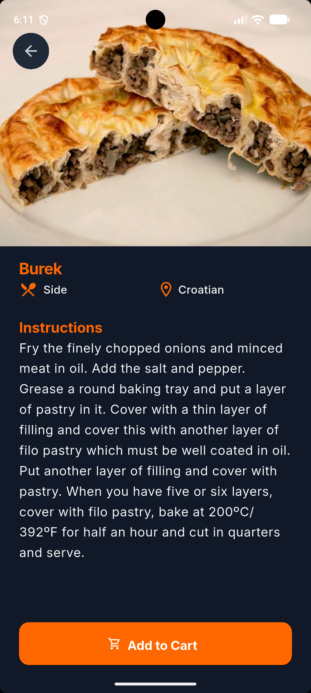<br><sub>Meal details · English · Dark</sub></td>
    <td align="center">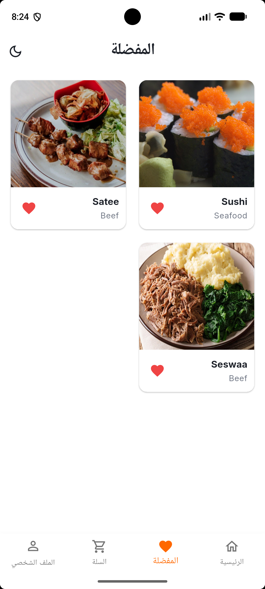<br><sub>Favorites · Arabic · Light</sub></td>
    <td align="center">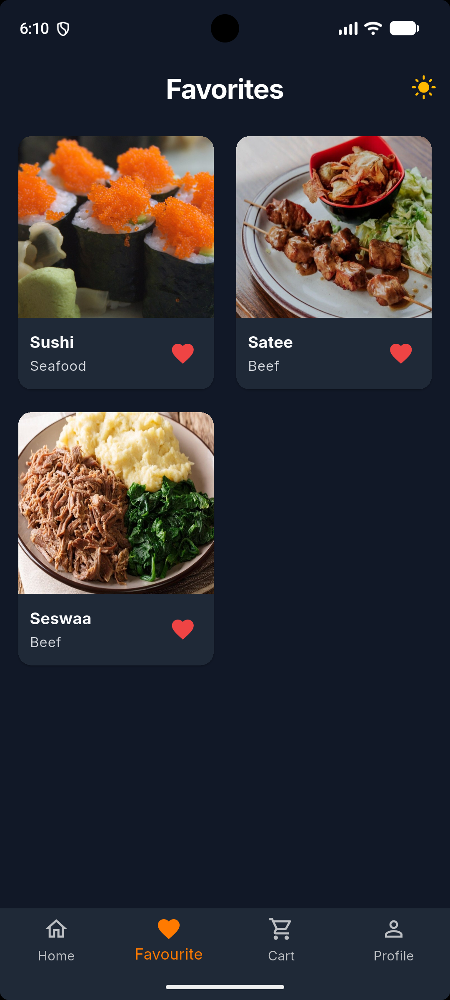<br><sub>Favorites · English · Dark</sub></td>
  </tr>
  <tr>
    <td align="center">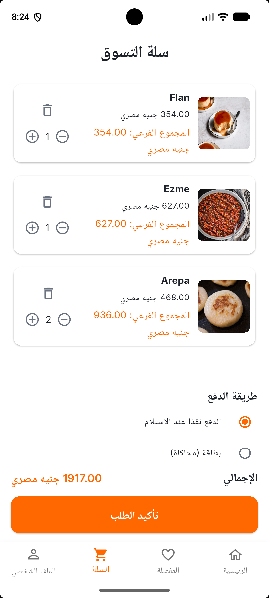<br><sub>Cart · Arabic · Light</sub></td>
    <td align="center">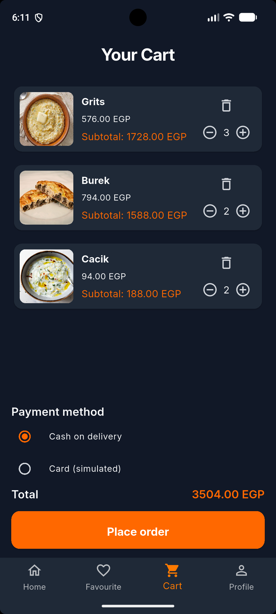<br><sub>Cart · English · Dark</sub></td>
    <td align="center"><br><sub>Profile · Arabic · Light</sub></td>
    <td align="center">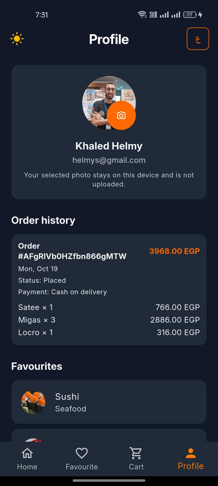<br><sub>Profile · English · Dark</sub></td>
  </tr>
</table>

## Built with

- **Flutter** and **Dart**
- **BLoC/Cubit** for state management and **GoRouter** for navigation
- **Firebase Authentication** and **Cloud Firestore** for accounts and user data
- **TheMealDB API** for meal data
- **Easy Localization** for English and Arabic
- **GetIt** for dependency injection
- **Dio** for networking

## Getting started

### Prerequisites

- Flutter SDK with Dart **3.10.1 or later** (within the Dart 3.x range).
- An Android or iOS device, emulator, or simulator.
- A Firebase project configured for the platforms you plan to run.

### Setup

1. Clone the repository and enter the project directory:

   ```bash
   git clone https://github.com/khalledhelmy/StreetBite.git
   cd StreetBite
   ```

2. Install the Flutter dependencies:

   ```bash
   flutter pub get
   ```

3. Configure Firebase. Register the app platforms, enable **Email/Password** sign-in and **Cloud Firestore**, then generate the platform options from the project root:

   ```bash
   dart pub global activate flutterfire_cli
   flutterfire configure
   ```

   Keep the generated Firebase configuration aligned with `lib/firebase_options.dart` and the native platform configuration. Apply appropriate Firebase Authentication and Firestore security rules before using real user accounts or data.

## Run the app

Connect a device or start an emulator/simulator, then run:

```bash
flutter run
```

Meal discovery uses TheMealDB and requires network access. Firebase-backed account, favorites, and order features require a working Firebase configuration.

## Testing and analysis

Run the project's tests and static analysis from the repository root:

```bash
flutter test
flutter analyze
```
